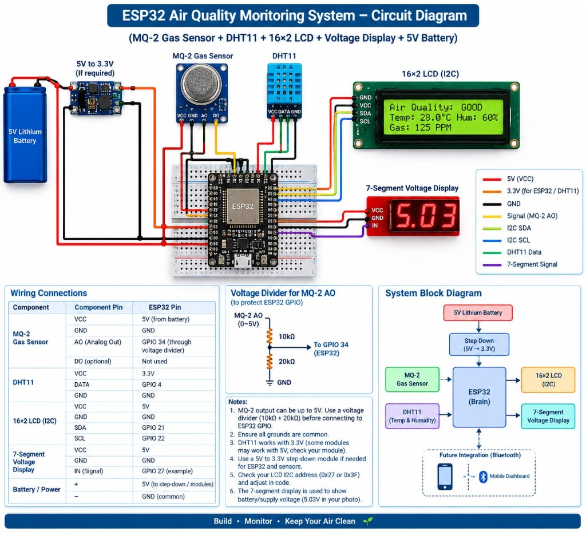
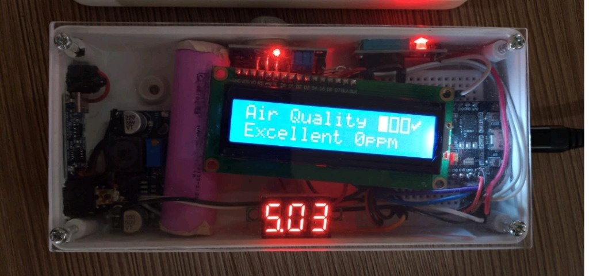
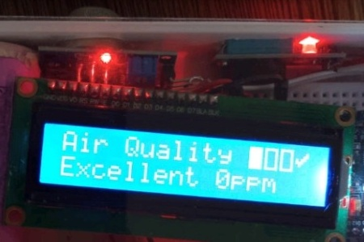
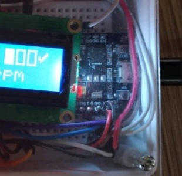

# ESP32 Air Quality Monitoring System

A compact, battery-powered IoT hardware project built using **ESP32 DevKit V1**, the **MQ Gas Sensor (MQ-2 / MQ-135)**, **DHT11 Temperature & Humidity Sensor**, and a **16x2 I2C LCD Display**. It continuously monitors ambient air quality in real-time, displays temperature and humidity, converts analog sensor readings into calibrated PPM metrics, and classifies air safety with visual icon indicators.

---

## 📁 Repository Directory Structure

```text
ESP32-Air-Quality-Monitoring-System/
│
├── README.md
│
├── Code/
│   └── air_quality_monitor.ino
│
├── Circuit_Diagram/
│   └── circuit_diagram.png         <-- Detailed schematic & wiring diagram
│
├── Hardware_Images/
│   ├── project_front.jpg           <-- Physical hardware prototype in acrylic box
│   ├── esp32_board.jpg             <-- ESP32 DevKit board close-up
│   ├── sensor_connections.jpg      <-- Gas sensor & power rail wiring
│   └── circuit_diagram.jpg         <-- Circuit schematic image
│
├── Documentation/
│   └── project_report.pdf          <-- 6-page comprehensive academic report
│
└── Future_Implementation/
    └── bluetooth_dashboard.md      <-- Bluetooth telemetry guide & code
```

---

## 🛠️ Hardware Components

| S.No | Component | Specification / Model | Purpose |
|:---:|:---|:---|:---|
| 1 | **Microcontroller** | ESP32 DevKit V1 (30-Pin / 38-Pin) | Processing core & ADC sampling |
| 2 | **Gas Sensor** | MQ-2 / MQ-135 Gas Sensor | Measures smoke, LPG, CO2, air contaminants |
| 3 | **Temp & Humidity** | DHT11 Digital Sensor | Measures temperature (°C) and humidity (%) |
| 4 | **Display** | 16x2 LCD with I2C Backpack (PCF8574) | Visualizes live readings (Address `0x27`) |
| 5 | **Battery Power** | 5V Lithium Rechargeable Battery | Self-contained, portable power supply |
| 6 | **Voltage Regulator** | 5V to 3.3V Step-Down / Boost Module | Clean regulated power rails |
| 7 | **Voltage Display** | 3-Digit 0.28" Mini Red LED 7-Segment | Shows active supply voltage (5.03V) |
| 8 | **Protection Resistors**| 10kΩ and 20kΩ Resistors | Voltage divider (protects ESP32 GPIO 34) |
| 9 | **Enclosure** | Custom Transparent Acrylic Box | Shock protection & lab demonstration |

---

## 🔌 Pin Connections & Wiring Table

| Component | Component Pin | ESP32 Pin / Power Connection | Description |
|:---|:---|:---|:---|
| **MQ Gas Sensor** | `VCC` | `5V` (from Battery rail) | Red Wire |
| | `GND` | `GND` | Black Wire |
| | `AO` (Analog Out) | `GPIO 34` (via 10k/20k Divider) | Yellow Wire (0–3.3V safe range) |
| **DHT11 Sensor** | `VCC` | `3.3V` | Red Wire |
| | `DATA` | `GPIO 4` | Green Wire (Digital Temp & Humidity) |
| | `GND` | `GND` | Black Wire |
| **16x2 LCD (I2C)** | `VCC` | `5V` | Red Wire |
| | `GND` | `GND` | Black Wire |
| | `SDA` | `GPIO 21` | Blue Wire (I2C Data) |
| | `SCL` | `GPIO 22` | Green Wire (I2C Clock) |
| **7-Segment Display**| `VCC` / `GND` | `5V` / `GND` | Red / Black Wire |
| | `IN` (Signal) | `GPIO 27` / Battery Rail | Measures battery voltage (5.03V) |

---

## 📊 16x2 LCD Live Display Format

The 16x2 LCD display simultaneously presents both the **MQ-2 Gas Sensor** data and the **DHT11 Temperature & Humidity** data:

- **Line 1 (Gas & Air Status):** `Gas: 125PPM  GOOD` (or `MOD `, `POOR`, `DANG`)
- **Line 2 (Climate Metrics):** `T:28.0C   H:60% `

| Gas PPM Reading | Air Quality Level | LCD Line 1 Output | Health Status |
|:---|:---:|:---|:---|
| **0 – 150 PPM** | **GOOD** | `Gas: 120PPM  GOOD` | Fresh, clean air |
| **151 – 350 PPM** | **MODERATE** | `Gas: 240PPM  MOD ` | Normal indoor atmosphere |
| **351 – 600 PPM** | **POOR** | `Gas: 450PPM  POOR` | Unhealthy for sensitive individuals |
| **> 600 PPM** | **DANGER** | `Gas: 780PPM  DANG` | High gas / smoke concentration |

---

## 🚀 How to Upload Code via Arduino IDE

1. **Install Arduino IDE:** Download from [Arduino Official Website](https://www.arduino.cc/en/software).
2. **Add ESP32 Board URL:**
   - Go to `File` > `Preferences`.
   - In "Additional Boards Manager URLs", add:
     ```text
     https://raw.githubusercontent.com/espressif/arduino-esp32/gh-pages/package_esp32_index.json
     ```
   - Go to `Tools` > `Board` > `Boards Manager`, search for **esp32** and click **Install**.
3. **Install Required Libraries:**
   - Go to `Sketch` > `Include Library` > `Manage Libraries...`
   - Search for **LiquidCrystal_I2C** and install.
   - Search for **DHT sensor library** (by Adafruit) and install (along with Unified Sensor if prompted).
4. **Open the Sketch:**
   - Open `Code/air_quality_monitor.ino`.
5. **Select Board & Port:**
   - Board: `DOIT ESP32 DEVKIT V1` (or `ESP32 Dev Module`).
   - Port: Select the active COM port (e.g., `COM3`, `COM4`).
6. **Upload & Monitor:**
   - Click **Upload**.
   - Open the **Serial Monitor** at baud rate **115200**.

---

## 📸 Hardware Prototype & Circuit Diagram

### Complete Circuit Diagram & Wiring Schematic


### Hardware Prototype Inside Enclosure


### Internal Modules & Connections
| Gas Sensor & Power Rail | ESP32 Core Controller |
|:---:|:---:|
|  |  |

---

## 📄 Documentation

- **Project Report:** A formal academic report is available at [`Documentation/project_report.pdf`](Documentation/project_report.pdf).
- **Future Scope:** Details and code for smartphone Bluetooth telemetry are in [`Future_Implementation/bluetooth_dashboard.md`](Future_Implementation/bluetooth_dashboard.md).
